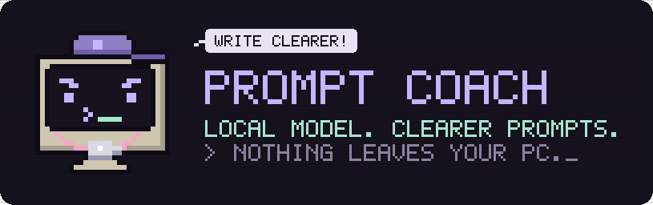

<p align="center">
  
</p>

<p align="center">
  <a href="https://github.com/HEX-1000/prompt-coach/actions/workflows/tests.yml"></a>
  
  
  
  
</p>

Prompt Coach checks a prompt before you send it to Claude. A local model, run by Ollama, restates what you mean and asks about anything unclear instead of guessing. Then the app builds the final prompt from your own text and your answers, and recommends which Claude model and effort level to use.

It runs on your PC, so it uses no Claude usage, and nothing leaves your machine.

## Why

How much a request costs depends mostly on two things: how many rounds it takes and which model answers it. A clear first prompt saves the rounds Claude would spend asking what you meant, and a routine task does not need the largest model. Prompt Coach makes that check before the request reaches Claude.

## How it works

1. **Write.** The app opens in **General Context**, ready to type. The empty prompt box lists the first keys to know. To use a project's glossary, press `tab` and pick the project from the **PROJECTS** list. Then type or paste your prompt and press `ctrl+s`.
2. **Clarify.** One model call restates what you mean and asks up to 3 questions. Codes such as `D5` or `A02` that are not in the project glossary are always asked about, never guessed ("term check"). In a question field, type an answer, press Enter or leave it empty to skip, or type `!` (or press `ctrl+l`) to leave the question to the assistant. The note field takes anything you want to add or correct. `ctrl+s` builds the prompt.
3. **Result.** The final prompt is your text unchanged, then your note, your answers, the questions left to the assistant, the project brief and the glossary lines of the terms it uses. Code builds it, not the model, so nothing in your text is dropped or reworded. You also get the recommended Claude model and effort. The prompt is already on the clipboard; edit it in place and copy again with `y` or `ctrl+y`.

With a project selected, the prompt carries that project's brief under `Project context (name):`, so the assistant knows what the project is without being told in every prompt. `b` removes the brief or adds it again and copies the result; the choice is remembered per project. The brief is attached as you wrote it and is never translated.

If the output language (`f4`) differs from the language of your text, the prompt is translated part by part and every part is checked for dropped numbers, URLs and codes, and for a part left untranslated. `o` shows the original and `t` translates again. A part that was translated once is not sent to the model a second time in the same run, so after you go back and change an answer only the new parts are translated; `t` sends all of them again. The checks cannot see a wrong idiom or a clause attached to the wrong noun, so read the translation before you send it. Leaving the language on `same` skips the translation.

If you answered a term check and a project is selected, `g` adds the term to that project's glossary.

Each finished run is saved to `history/` as JSON, on your PC only.

## Requirements

- Windows 10 or 11, with [Windows Terminal](https://aka.ms/terminal) for the full look (the app also runs in a plain console)
- Python 3.10 or newer, from [python.org](https://www.python.org/downloads/)
- [Ollama](https://ollama.com/download) with at least one model:

| Model | VRAM at the default 8K context | Measured on an RTX 3050 8 GB |
|---|---|---|
| `qwen3.5:9b` (default) | about 5.6 GB | 35 tokens/s, fully on the GPU |
| `qwen3.5:4b` | about 3.3 GB | 55 tokens/s, fully on the GPU |

## Install

**1. Install Ollama.** When it asks you to create an account, choose **No thanks, I'll use Ollama locally**.

**2. Download a model.** In PowerShell:

```powershell
ollama pull qwen3.5:9b
```

On a GPU with less than 8 GB, use `qwen3.5:4b` instead, and move it to the top of the `models` list in `config.json`. The first model in that list is the default.

**3. Download this repository.** Click **Code > Download ZIP** and extract it to a folder you will keep, for example `C:\Programs\prompt-coach`. Or:

```powershell
git clone https://github.com/HEX-1000/prompt-coach.git
```

**4. Run the installer** in that folder (open the folder in File Explorer, type `powershell` in the address bar, press Enter):

```powershell
powershell -ExecutionPolicy Bypass -File .\install.ps1
```

It creates a Python environment in `.venv` with [Textual](https://textual.textualize.io/), a Windows Terminal profile called **Prompt Coach** with its own color scheme and icon, and a desktop shortcut. Run it again if you move the folder.

At the end it checks that Ollama is installed and running and that one of the models in `config.json` is downloaded. Anything missing is listed under **Before you start**, with the command to fix it. These checks only warn; the app is installed either way. The installer uses the newest Python 3.10 or newer it finds: first the Python install manager's folder, then the `py` launcher, then `python` on PATH. If there is none, or the one it finds is older than 3.10, it stops with a link to the download.

**5. Add a project context (optional).** Copy `contexts\_template.md` to a new file, for example `contexts\my-project.md`, and fill in the project name, a short brief (what the project is, its goal, where it stands now) and a glossary of your own terms (a list under a `## Glossary` heading, one `- TERM: meaning` per line). The `name:` line is what the PROJECTS list shows. The coach reads the context before every run, so it knows what your abbreviations mean, and it attaches the glossary lines of the terms your prompt uses. Optional `include:` paths, such as a project's `CLAUDE.md`, are read fresh each time; only the local model reads them. Without any context file, General Context is all you see, and every project term gets asked about.

The brief is the text of the project file without its title line, its glossary and its comments; in the template that is the paragraph above the glossary. It goes into every final prompt for that project, so write only what the assistant may read. Keep it under 2,000 characters: a longer brief is cut at a paragraph break, with a warning (the limit is `brief_max_chars` in `config.json`). If the project keeps a short description of its own, point the front matter key `brief:` at that file, for example `brief: D:\path\to\project\docs\BRIEF.md`. That file is then read fresh on every run and attached instead.

**6. Start it** from the desktop shortcut, or open Windows Terminal and choose **Prompt Coach**.

## Keys

| Key | Action |
|---|---|
| `ctrl+s` or `f5` | next step (build, on the clarify screen) |
| `ctrl+l` | leave this question to the assistant (types `!`) |
| `ctrl+n` | new prompt |
| `f2` | paste from the clipboard |
| `f3` | switch model |
| `f4` | output language: same, English, Turkish |
| `y` or `ctrl+y` | copy the result |
| `o` | result: switch between the original and the translation |
| `t` | result: translate again |
| `b` | result: remove or add the project brief, and copy |
| `g` | result: save answered term checks to the project glossary |
| `esc` | back |
| `f1` | all keys (`?` also works when the cursor is not in a text box) |
| `ctrl+q` | quit |

## Files

| File | Purpose |
|---|---|
| `coach_tui.py` | the terminal app |
| `coach_core.py` | shared logic: config, contexts, the session (understand, build, translate, save), clipboard |
| `coach_text.py` | text functions without side effects: language guess, glossary, project brief, prompt assembly, translation checks |
| `targets/claude.json` | which Claude model and effort go with each depth label |
| `coach_update.py` | the launch-time update check, see [Updates](#updates) |
| `VERSION` | the installed version, compared with the one on GitHub |
| `CHANGELOG.md` | what changed in each version, newest first |
| `tests/` | `python -B -m unittest discover -s tests`; GitHub runs them on Windows and Linux with Python 3.10, 3.12 and 3.14 |
| `prompt_coach.py` | plain terminal version, standard library only: `python -B prompt_coach.py --project my-project "your prompt"`; `--no-brief` leaves the project brief out |
| `contexts/*.md` | one file per project, with its brief and its glossary; files starting with `_` are not listed |
| `rules/` | no longer used, see [rules/README.md](rules/README.md) |
| `tools/replay.py` | local tool: scores saved history records and replays the pipeline on them (`--saved` needs no model) |
| `config.json` | Ollama address, models, context size, temperature, question limit, brief length, target |

## Updates

After the TUI is up, it reads one small file, `VERSION`, from this repository on GitHub, in the background, so an offline start does not wait. A version counts as available only when its release tag `vX.Y.Z` exists and holds the same `VERSION`. The app then shows "Version X is available. F6 installs it and restarts." F6 stores the text in the prompt box, installs the version from the tag, starts the new version and puts the text back. The notice after the restart lists what changed, taken from [CHANGELOG.md](CHANGELOG.md). It shows at most 5 lines and points to the file for the rest. If the install fails, you get the reason and the old version keeps running.

- Your `contexts/`, `rules/`, `history/`, `config.json` and `.state.json` are never touched. Replaced files are copied to `.update_backup/` first.
- A ZIP download is updated from the ZIP of the release tag. Every Python file is checked for syntax errors before anything is written.
- A `git clone` of this repository fetches the tag and merges it with `--ff-only`, unless a tracked file other than `config.json` has local edits. Then it skips the update and tells you.
- A version on `main` that has no tag yet is not offered.
- A clone of a fork is not updated.
- If GitHub cannot be reached, nothing happens and the app starts as usual.

`auto_update` in `config.json` has three values: `true` (the default) checks and tells you, `"install"` installs on launch without asking, `false` does not check. You can also run the update yourself with `python -B coach_update.py`.

Updating means running code downloaded from this repository, so the repository owner's GitHub account is trusted the same way it is when you first download the app. Versions before 1.1.0 have no update check. Run `git pull` or download the ZIP again once, and later updates come by themselves.

## Privacy

The coach talks only to Ollama on `localhost`. The one other connection is the update check above: plain requests to `raw.githubusercontent.com` and `github.com`, with no prompt, context or history in them. Your contexts and history stay in this folder, and `.gitignore` keeps them out of Git if you fork the repository. The project brief and the glossary lines that the coach attaches are part of the final prompt, so they go wherever you paste that prompt.

## Limitations

- The coach is a small local model. Its questions and its depth label are good defaults, not guarantees; read the result before you send it. In a trial on four saved prompts, 15 of 27 kept questions were worth asking.
- A translation can carry a wrong meaning that the checks cannot see. It is off by default (`same`).
- The context window is 8192 tokens. A project context that does not fit is cut at the end, with a warning; raise `num_ctx` in `config.json` and add `"config_version": 2` to read more.
- The installer and the clipboard code are for Windows.
- Ollama must be running. If it is not, the app shows a red dot and a notice, and checks again when you press `ctrl+s`. If Ollama is not installed at all, the notice gives the download link.
- The app warns only about the model it is set to use. If that model is not downloaded, the notice gives the `ollama pull` command and, when another model from `config.json` is installed, points to `f3`.
- The update check needs internet access. Without it, the app works as before and skips the check.

## Questions and problems

Questions and ideas go to [Discussions](https://github.com/HEX-1000/prompt-coach/discussions). If something is broken, open an [issue](https://github.com/HEX-1000/prompt-coach/issues) and say what you did and what the app showed. Both pages are public: remove your own prompt text, context files, history records and the Windows user name in file paths before you post, or replace them with a made-up example that shows the same problem.

## Related

[Token Optimization System](https://github.com/HEX-1000/token-optimization-system): a local MCP server that gives Claude a few relevant sections of your files instead of whole documents.

[Research Radar](https://github.com/HEX-1000/research-radar): a daily scan of new GitHub repositories, arXiv papers and Hugging Face models that keeps the few that fit your interests and writes a short note on each, with a local Ollama model.

## License

[MIT](LICENSE). Made by [HEX-1000](https://github.com/HEX-1000).
