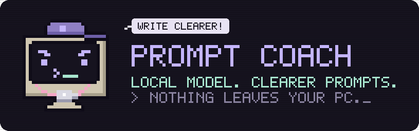

<p align="center">
  
</p>

<p align="center">
  
  
  
  
</p>

Prompt Coach checks a prompt before you send it to Claude. A local model, run by Ollama, restates what you mean, repairs the text and asks about anything unclear instead of guessing. Once the meaning is settled, it gives you the final prompt and recommends which Claude model and effort level to use.

It runs on your PC, so it uses no Claude usage, and nothing leaves your machine.

## Why

How much a request costs depends mostly on two things: how many rounds it takes and which model answers it. A clear first prompt saves the rounds Claude would spend asking what you meant, and a routine task does not need the largest model. Prompt Coach makes that check before the request reaches Claude.

## How it works

1. **Write.** The app opens in **General Context**, ready to type. To use a project's glossary, press `tab` and pick the project from the **PROJECTS** list. Then type or paste your prompt and press `ctrl+s`.
2. **Clarify.** The coach restates what you mean, shows the repaired text and asks what it needs to know. Codes such as `D5` or `A02` that are not in the project context are always asked about, never guessed ("term check"). Answer, leave a field empty to skip, or type a correction. `ctrl+s` sends the answers. When the understanding is right and nothing is open, `ctrl+s` builds the prompt.
3. **Result.** You get the final prompt, the recommended Claude model and effort, and anything still missing. The prompt is already on the clipboard; edit it in place and copy again with `y` or `ctrl+y`.

Each finished run is saved to `history/` as JSON, on your PC only.

## Requirements

- Windows 10 or 11, with [Windows Terminal](https://aka.ms/terminal) for the full look (the app also runs in a plain console)
- Python 3.10 or newer, from [python.org](https://www.python.org/downloads/)
- [Ollama](https://ollama.com/download) with at least one model:

| Model | VRAM at the default 16K context | Measured on an RTX 3050 8 GB |
|---|---|---|
| `qwen3.5:9b` (default) | about 6.5 GB | 32 tokens/s, partly on the CPU |
| `qwen3.5:4b` | about 3.4 GB | 57 tokens/s, fully on the GPU |

## Install

**1. Install Ollama.** When it asks you to create an account, choose **No thanks, I'll use Ollama locally**.

**2. Download a model.** In PowerShell:

```powershell
ollama pull qwen3.5:9b
```

On a GPU with less than 8 GB, use `qwen3.5:4b` instead, and move it to the top of the `models` list in `config.json`. The first model in that list is the default.

**3. Download this repository.** Click **Code > Download ZIP** and extract it to a folder you will keep, for example `C:\Programs\prompt-coach`. Or:

```powershell
git clone https://github.com/HEX-1000/prompt-coach.git
```

**4. Run the installer** in that folder (open the folder in File Explorer, type `powershell` in the address bar, press Enter):

```powershell
powershell -ExecutionPolicy Bypass -File .\install.ps1
```

It creates a Python environment in `.venv` with [Textual](https://textual.textualize.io/), a Windows Terminal profile called **Prompt Coach** with its own color scheme and icon, and a desktop shortcut. Run it again if you move the folder.

**5. Add a project context (optional).** Copy `contexts\_template.md` to a new file, for example `contexts\my-project.md`, and fill in the project name, a one-line description and a glossary of your own terms. The `name:` line is what the PROJECTS list shows. The coach reads the context before every run, so it knows what your abbreviations mean. Optional `include:` paths, such as a project's `CLAUDE.md`, are read fresh each time. Without any context file, General Context is all you see, and every project term gets asked about.

**6. Start it** from the desktop shortcut, or open Windows Terminal and choose **Prompt Coach**.

## Keys

| Key | Action |
|---|---|
| `ctrl+s` or `f5` | next step |
| `ctrl+b` | build the prompt now |
| `ctrl+n` | new prompt |
| `f2` | paste from the clipboard |
| `f3` | switch model |
| `f4` | output language: same, English, Turkish |
| `y` or `ctrl+y` | copy the result |
| `esc` | back |
| `?` or `f1` | all keys |
| `ctrl+q` | quit |

## Files

| File | Purpose |
|---|---|
| `coach_tui.py` | the terminal app |
| `coach_core.py` | shared logic: contexts, the two stages, clipboard |
| `coach_update.py` | the launch-time update check, see [Updates](#updates) |
| `VERSION` | the installed version, compared with the one on GitHub |
| `tests/` | `python -B -m unittest discover -s tests` |
| `prompt_coach.py` | plain terminal version, standard library only: `python -B prompt_coach.py --project my-project "your prompt"` |
| `contexts/*.md` | one file per project; files starting with `_` are not listed |
| `rules/` | optional writing rules, see [rules/README.md](rules/README.md) |
| `config.json` | Ollama address, models, context size, temperatures, question limit |
| `prompt_coach_v1.py` | the earlier single-stage script, kept for comparison |

## Updates

When the TUI starts, it reads one small file, `VERSION`, from this repository on GitHub. If the version there is newer than yours, it installs the new files and starts the new version. You see one line in the console and a notice in the app.

- Your `contexts/`, `rules/`, `history/`, `config.json` and `.state.json` are never touched. Replaced files are copied to `.update_backup/` first.
- A ZIP download is updated from the repository ZIP. Every Python file is checked for syntax errors before anything is written.
- A `git clone` of this repository is updated with `git pull --ff-only`, unless a tracked file other than `config.json` has local edits. Then it skips the update and tells you.
- A clone of a fork is not updated.
- If GitHub cannot be reached, nothing happens and the app starts as usual.

To turn it off, add `"auto_update": false` to `config.json`. You can also run the check yourself with `python -B coach_update.py`.

Updating means running code downloaded from this repository, so the repository owner's GitHub account is trusted the same way it is when you first download the app. Versions before 1.1.0 have no update check. Run `git pull` or download the ZIP again once, and later updates come by themselves.

## Privacy

The coach talks only to Ollama on `localhost`. The one other connection is the update check above: plain requests to `raw.githubusercontent.com` and `github.com`, with no prompt, context or history in them. Your contexts, rules and history stay in this folder, and `.gitignore` keeps them out of Git if you fork the repository.

## Limitations

- The coach is a small local model. Its questions and its model recommendation are good defaults, not guarantees; read the result before you send it.
- The installer and the clipboard code are for Windows.
- Ollama must be running.
- The update check needs internet access. Without it, the app works as before and skips the check.

## Related

[Token Optimization System](https://github.com/HEX-1000/token-optimization-system): a local MCP server that gives Claude a few relevant sections of your files instead of whole documents.

## License

[MIT](LICENSE). Made by [HEX-1000](https://github.com/HEX-1000).
